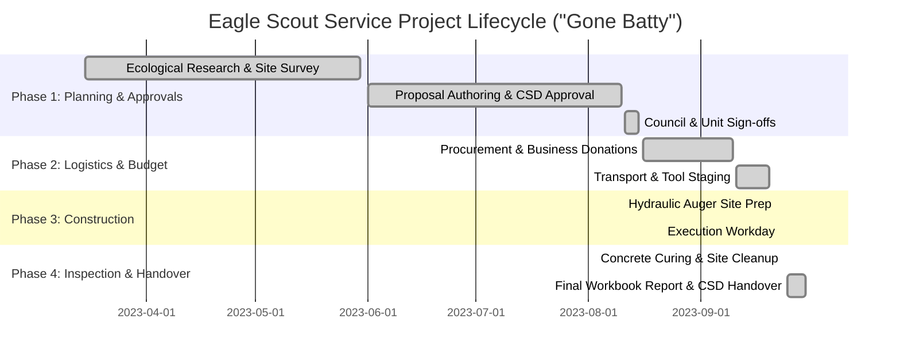

#  Eagle Scout Service Project Portfolio & Showcase
## Wildlife Habitat & Conservation Initiative ("Gone Batty")

[](https://opensource.org/licenses/MIT)
[](#technical-architecture)
[](#technical-architecture)
[](#technical-architecture)
[](#leadership--project-impact)
[-success)](#project-milestones)

> **Interactive digital portfolio and technical showcase documenting the ecological engineering, community partnerships, field logistics, and volunteer leadership behind Austin Mirando's Eagle Scout Service Project at Lake Forest Park in El Dorado Hills, CA.**

---

## 📌 Executive Summary

The **"Gone Batty" Eagle Scout Service Project Portfolio** is a lightweight, responsive web showcase documenting the end-to-end development of two predator-proof bat conservation roosts constructed for the **El Dorado Hills Community Services District (EDH CSD)** at **Lake Forest Park**.

Beyond serving as the official digital accompaniment for the Eagle Scout Board of Review, this project demonstrates:
1. **Ecological Engineering & Field Leadership**: Designing 12-foot elevated, thermal-retentive wildlife habitats, directing a mixed volunteer crew through dense rocky excavation, and coordinating public agency approvals.
2. **Modern Web Engineering**: A clean, accessible, and high-performance single-page application built with semantic HTML5, modern CSS custom properties, and native `IntersectionObserver` scroll-spy navigation.

---

## 📄 Resume-Ready Experience Bullets

### Project Management & Engineering Leadership (Eagle Scout Candidate)
- **Field Leadership & Volunteer Direction**: Supervised the design, material preparation, and safe structural elevation of two predator-proof bat conservation houses, directing **11 youth and adult volunteers** over **133.5 total labor hours** with **zero safety incidents**.
- **Ecological Engineering & Specifications**: Formulated thermal and structural specifications to maximize colony adoption: engineered structures with **12-foot predator-resistant ground clearance**, **Southeast solar alignment** (capturing 6–8 hours of morning warmth), and **dark-toned pressure-treated timber** to sustain critical 85°F–100°F maternity roost temperatures.
- **Problem Solving & Field Adaptation**: Overcame heavily compacted, rocky soil at Lake Forest Park by procuring a towable hydraulic auger, coordinating sledgehammer-driven steel rebar ground anchors, and establishing an on-site municipal water connection with park staff.
- **Stakeholder Collaboration & Sponsorship**: Partnered with the **El Dorado Hills Community Services District (CSD)** for site permits and negotiated 100% self-funded project support—securing timber donations from ProBuilders (Placerville), catering from Steve's Pizza, and hardware discounts from Home Depot ($0 cost to the municipal beneficiary).

### Frontend Web Development (Portfolio Web App)
- **Zero-Dependency Architecture**: Engineered a responsive, single-page portfolio using **vanilla HTML5, CSS3, and ES6+ JavaScript**, achieving near-instant load times with zero third-party framework overhead.
- **Dynamic Interaction & Navigation**: Implemented fluid scroll-spy navigation and mobile drawer toggles powered by the native browser **`IntersectionObserver` API** and passive event listeners.
- **Design System & A11y Standards**: Architected a maintainable CSS token design system utilizing CSS Custom Properties, CSS Grid / Flexbox layouts, fluid typography, and WCAG AA contrast compliance.

---

## Verified Project Impact by the Numbers

| Metric | Official Record | Impact & Technical Details |
| :--- | :--- | :--- |
| **Total Project Labor** | **133.5 Hours** | 83.5 candidate leadership hours (67.5 planning + 16 execution) + 50 volunteer service hours. |
| **Volunteer Team Led** | **11 People** | Directed 5 youth Scouts, 4 adult leaders, and 1 community parent across field operations. |
| **Budget & Financials** | **$562.17 Raised / $481.66 Spent** | 100% self-funded via scout account earnings & local business sponsorships ($0 beneficiary cost). |
| **Conservation Roosts** | **2 Predator-Proof Units** | Dual Kenley outdoor conservation roosts mounted on 4"x6"x20' pressure-treated timber beams. |
| **Elevation & Clearance** | **12+ Feet** | 100% predator-proof drop height protecting nursing pups from ground predators. |
| **Solar Orientation** | **Southeast (135°)** | Maximizes morning solar gain to achieve the 85°F–100°F nursery temperature range. |
| **Safety Record** | **100% Incident-Free** | Mandatory morning safety briefings, rattlesnake sweeps, PPE, and hydration stations. |
| **Ecological Benefit** | **Natural Pest Control** | Each bat colony consumes up to 1,000 mosquitoes/pests per hour, protecting park visitors naturally. |

---

## Technical Architecture & Stack

```
/
├── index.html        # Semantic HTML5 (Hero, Mission, Technical Specs, Metrics, Phases, Gallery, Reflection, Contact)
├── styles.css        # CSS design token system, responsive grid/flexbox layouts, card hover micro-animations
├── script.js         # Lightweight ES6+ script (IntersectionObserver scroll-spy, drawer toggle, smooth scroll)
└── README.md         # Comprehensive project documentation & resume-ready showcase
images/               # Host of site images       
```

### Key Technical Implementations
- **Semantic Structure**: Built with native `<header>`, `<nav>`, `<main>`, `<section>`, and `<footer>` elements for screen-reader accessibility and clean document hierarchy.
- **CSS Design Tokens (`:root`)**:
  - **Forest Green** (`#1B3D2B`) — Nature & conservation identity
  - **Navy Blue** (`#162846`) — Traditional BSA scouting blue
  - **Charcoal** (`#1F2421`, `#2F353B`) — Accessible, high-contrast body typography
  - **Off-White** (`#F8FAF8`) — Clean, balanced card surfaces
- **IntersectionObserver Scroll-Spy**: High-performance section tracking that eliminates expensive `scroll` event calculations.
- **Fluid Responsiveness**: Custom media queries engineered for optimal layouts across mobile devices (320px+), tablets, laptops, and ultra-wide screens.

---

## Project Milestones & Lifecycle



1. **Phase 1: Ecological Research, Proposal & Approvals (March – August 2023)**:
   Researched maternal bat roosting needs, surveyed Lake Forest Park with CSD Representative Chelsea Harrison, authored formal proposal with tool hazard assessments, and secured unanimous approvals from the CSD, Scoutmaster Keith Underwood, Committee Chair Denise Johnson, and District Advancement Chair Eric Miller.
2. **Phase 2: Budgeting, Procurement & Sponsorships (August – September 2023)**:
   Funded via troop tree-pickup earnings. Negotiated material sponsorships from ProBuilders (20-ft beams), Steve's Pizza (volunteer lunch), Home Depot (supply discounts), and Mr. Lindholm (heavy transport). Staged safety PPE and tools.
3. **Phase 3: Site Prep, Excavation & Elevation (September 22–23, 2023)**:
   Pre-drilled deep post holes through rocky ground using a towable hydraulic auger. Conducted safety briefings and rattlesnake sweeps. Directed volunteer teams in pre-assembling bat houses to 20-ft posts, driving rebar ground anchors, plumbing posts with guide stakes, connecting to park water, and pouring 10 bags of concrete with water-shedding slopes.
4. **Phase 4: Inspection, Site Cleanup & Municipal Handover (September 24, 2023)**:
   Inspected structural stability after curing, removed wooden bracing and caution tape, conducted complete grounds trash sweep, returned unused materials, completed official Eagle workbook documentation, and delivered the conservation structures to the community.

---

## Quick Start & Local Preview

This project requires **zero build tools or dependencies**.

### Option 1: Direct File Launch
Simply double-click [`index.html`](/eaglescout/index.html) in your file explorer or open it in any web browser.

### Option 2: Local HTTP Server
```bash
# Clone the repository
git clone https://github.com/austinhttps/gonebatty-eaglescout.git
cd gonebatty-eaglescout

# Start a lightweight local server (Python 3)
python -m http.server 8000
```
Open `http://localhost:8000` in your web browser.

### Option 3: GitHub Pages Deployment
1. Go to repository **Settings** > **Pages**.
2. Under **Build and deployment** > **Source**, choose **Deploy from a branch**.
3. Select `main` branch and `/ (root)` folder, then click **Save**.
4. The site will be live at `https://username.github.io/gonebatty-eaglescout/`.

---

## 🎯 Core Competencies Demonstrated

| Technical Competencies | Leadership & Management Competencies |
| :--- | :--- |
| Semantic HTML5 & Web Standards | Cross-Functional Team Leadership (Youth & Adults) |
| Responsive Layouts (CSS Grid / Flexbox) | Public Agency & Municipal Collaboration (EDH CSD) |
| Vanilla JavaScript (DOM & IntersectionObserver) | Field Problem Solving (Hydraulic Auger & Rebar Pinning) |
| Performance Optimization (Zero Dependencies) | Resource Procurement & Business Sponsorships |
| Git Version Control & Deployment | Health, Safety & Risk Mitigation (Zero Incidents) |

---

## 📬 Contact & Project Verification

- **Eagle Scout**: Austin Mirando (`austinjmirando@gmail.com`)
- **Unit**: Troop 454, American River District, Golden Empire Council, Boy Scouts of America
- **Scoutmaster**: Keith Underwood
- **Unit Committee Chair**: Denise Johnson
- **Beneficiary**: El Dorado Hills Community Services District (EDH CSD)
- **Beneficiary Representative**: Chelsea Harrison (`charrison@edhcsd.org` • 1021 Harvard Way, El Dorado Hills, CA 95762)
- **Project Location**: Lake Forest Park, El Dorado Hills, CA
- **Repository**: [austinhttps/gonebatty-eaglescout](https://github.com/austinhttps/gonebatty-eaglescout)
- **Documentation**: Official BSA Eagle Scout Service Project Workbook (February 2023 ed.) verified and approved.
