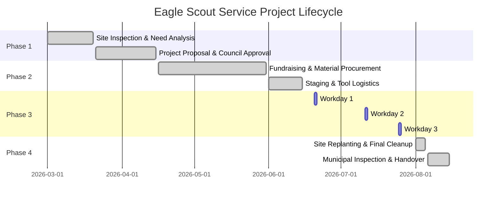

# 🦅 Eagle Scout Service Project Portfolio & Showcase

[](https://opensource.org/licenses/MIT)
[](#technical-architecture)
[](#technical-architecture)
[](#technical-architecture)
[](#leadership--project-impact)
[](#project-milestones)

> **Interactive digital portfolio and technical showcase documenting the planning, community fundraising, engineering execution, and cross-functional leadership of an Eagle Scout Service Project.**

---

## 📌 Executive Summary

The **Eagle Scout Service Project Portfolio** is a responsive, zero-dependency web application designed to document and present the end-to-end lifecycle of an Eagle Scout Service Project: the **Pine Creek Nature Trail Restoration & Wetland Boardwalk Build** (*Clearwater Nature Center & City Parks Dept.*).

Beyond serving as an official project workbook accompaniment for the Eagle Scout Board of Review, this repository demonstrates:
1. **Engineering & Project Management**: Managing a $4,320 budget, 36 volunteers, 248 labor hours, and multi-agency municipal approvals.
2. **Software Craftsmanship**: A lightweight, accessible, high-performance web portfolio built using semantic HTML5, a cohesive CSS design token system, and modern JavaScript (`IntersectionObserver`).

---

## 📄 Resume-Ready Experience Bullets

*The bullet points below are structured in Google-recommended XYZ format (**"Accomplished [X] as measured by [Y], by doing [Z]"**) for direct use on software engineering, product management, and leadership resumes.*

### 🛠️ Project Management & Leadership (Eagle Scout Candidate)
- **Cross-Functional Team Leadership**: Mobilized, trained, and directed **36 youth and adult volunteers** across **248 total volunteer hours**, maintaining strict safety protocols with **zero accidents or safety incidents** across 3 intensive field workdays.
- **Budgeting & Fiscal Management**: Raised and administered a **$4,320 capital budget** with 100% community self-funding through municipal fundraising events and wholesale vendor negotiations.
- **Stakeholder Alignment & Permitting**: Coordinated approvals and environmental compliance across 4 stakeholder bodies, including the **City Parks Department, Clearwater Nature Center Board, Troop Leadership, and District Advancement Committee**.
- **Field Engineering & Problem Solving**: Adapted foundation engineering on-site to overcome unexpected saturated soil conditions by designing reinforced sleeper sills and drainage gravel beds, preventing schedule delays.

### 💻 Frontend Web Development (Portfolio Web App)
- **Zero-Dependency Architecture**: Developed a production-ready, mobile-responsive single-page portfolio using **vanilla HTML5, CSS3, and ES6+ JavaScript**, achieving sub-second load times without third-party frameworks.
- **Dynamic Interaction & Navigation**: Implemented scroll-spy active state tracking and optimized viewport updates utilizing the browser's native **`IntersectionObserver` API** and passive event listeners.
- **Modern UI & Design System**: Engineered a custom CSS design system using CSS custom properties (variables), flexible CSS Grid / Flexbox layouts, fluid typography, and WCAG AA accessible color contrast ratios.

---

## 📊 Project Impact by the Numbers

| Metric | Achievement | Impact & Details |
| :--- | :--- | :--- |
| **Volunteer Labor** | **248 Hours** | Combined hours spanning feasibility, fundraising, site prep, and construction. |
| **Volunteers Directed** | **36 People** | Youth Scouts, adult leaders, and local community volunteers safely supervised. |
| **Capital Raised** | **$4,320** | 100% self-funded through organized car washes and local business lumber discounts. |
| **Physical Scope** | **110 Linear Feet** | Elevated wooden boardwalk over flood-prone wetland with safety kickrails and ramps. |
| **Safety Record** | **100% Incident-Free** | Strict adherence to BSA *Guide to Safe Scouting* and hazard briefing protocols. |
| **Community Benefit** | **Year-Round Access** | Restored seasonal park access for over 5,000 annual hikers, students, and seniors. |

---

## 🏛️ Technical Architecture & Stack

```
eaglescout/
├── index.html        # Semantic HTML5 structure (Hero, Mission, Metrics, Timeline, Gallery, Reflection)
├── styles.css        # Custom CSS design system, typography tokens, grid & responsive layouts
├── script.js         # Modular ES6+ JavaScript (IntersectionObserver scroll-spy, mobile drawer)
└── README.md         # Professional documentation & project retrospective
```

### Key Technical Implementations
- **Semantic DOM Structure**: Built with `<header>`, `<nav>`, `<main>`, `<section>`, and `<footer>` elements for screen-reader accessibility and clean document hierarchy.
- **CSS Design Tokens**: Defined in `:root` for maintainability:
  - **Forest Green** (`#1B3D2B`) — Nature & conservation theme
  - **Navy Blue** (`#162846`) — Traditional BSA scouting blue
  - **Charcoal** (`#1F2421`, `#2F353B`) — High-contrast, legible typography
  - **Off-White** (`#F8FAF8`) — Balanced whitespace and modern card surfaces
- **IntersectionObserver Scroll-Spy**: Replaced expensive `window.onscroll` calculations with an efficient `IntersectionObserver` instance with root margins for seamless navigation highlighting.
- **Fluid & Responsive Layout**: Pure CSS media queries ensuring an optimal experience from small mobile screens (320px) up to 4K desktop displays.

---

## 🗓️ Project Milestones & Lifecycle



1. **Phase 1: Proposal & Governance (Months 1–2)**:
   Drafted detailed engineering sketches, material cost projections, hazard assessments, and obtained formal sign-offs from the beneficiary, Scoutmaster, Committee Chair, and District Advancement Chair.
2. **Phase 2: Capital Campaign & Logistics (Months 3–4)**:
   Secured $4,320 in financing, sourced pressure-treated lumber and galvanized hardware, and staged first aid, safety PPE, and hydration stations.
3. **Phase 3: Construction & Operational Leadership (Month 5)**:
   Led 3 structured build days. Delegated responsibilities to specialized sub-teams (excavation, framing, cutting, fastening) while maintaining an executive supervisory role.
4. **Phase 4: Inspection, Environmental Remediation & Handover (Month 6)**:
   Cleaned surrounding wetlands, reseeded native grasses along trail banks, completed project workbook logs, and achieved final municipal sign-off.

---

## 🚀 Quick Start & Local Preview

This project requires **zero build tools or dependencies**.

### Option 1: Direct File Launch
Simply double-click [`index.html`](file:///c:/Users/Austi/OneDrive/CodingProjects/AGY/eaglescout/index.html) in your file explorer or open it in any modern browser.

### Option 2: Local HTTP Server
```bash
# Clone the repository
git clone https://github.com/austinhttps/gonebatty-eaglescout.git
cd gonebatty-eaglescout

# Start a lightweight local server (Python 3)
python -m http.server 8000
```
Visit `http://localhost:8000` in your web browser.

### Option 3: GitHub Pages Deployment
1. Go to repository **Settings** > **Pages**.
2. Under **Build and deployment** > **Source**, choose **Deploy from a branch**.
3. Select `main` branch and `/ (root)` folder, then click **Save**.
4. The site will be live at `https://austinhttps.github.io/gonebatty-eaglescout/`.

---

## 🎯 Core Competencies Demonstrated

| Technical Competencies | Leadership & Management Competencies |
| :--- | :--- |
| Semantic HTML5 & Web Standards | Cross-Functional Team Leadership |
| Responsive Design & CSS Grid / Flexbox | Capital Campaign & Budgeting |
| Vanilla JavaScript (DOM & Browser APIs) | Stakeholder Management & Public Relations |
| Performance Optimization & Clean Code | Risk Management & Field Safety |
| Git Version Control & Deployment | Resource Allocation & Logistics Planning |

---

## 📬 Contact & Verification

- **Eagle Scout Candidate**: Austin Mirando
- **Unit**: Troop 42, Great Trail Council, Boy Scouts of America
- **Beneficiary**: Clearwater Nature Center & Municipal Parks Department
- **Repository**: [austinhttps/gonebatty-eaglescout](https://github.com/austinhttps/gonebatty-eaglescout)
- **Documentation**: Official BSA Eagle Scout Service Project Workbook available upon request.
